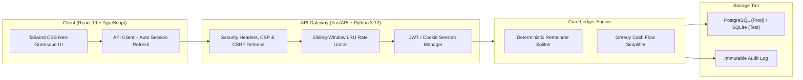

# PocketCircle

**A high-integrity shared expense ledger and debt simplification engine for friend groups.**

PocketCircle solves the friction of shared expenses across trips, housemates, and dinners. It eliminates floating-point rounding errors, tracks multi-payer contributions, enforces strict authorization boundaries, and simplifies complex debts into the minimum possible transfers ($\le N-1$).

---

## Key Features

- **Robust Authentication:** Google OAuth 2.0 and Email OTP verification with PBKDF2 salted passwords and timing-attack defenses.
- **Strict Financial Integrity:** Zero floating-point math; all monetary logic is implemented using Python's `Decimal` quantized to two decimal places (`0.01`).
- **Flexible Splitting:** Equal and exact splits with deterministic remainder paisa allocation.
- **Multi-Payer Contributions:** Multiple circle members can co-fund a single bill.
- **Greedy Debt Simplification:** Reduces circular and transitive debts into the theoretical minimum number of transactions using a greedy cash-flow algorithm.
- **Off-Platform Settlements:** Record cash/UPI settlements with mandatory payee-only confirmation and row-level locking.
- **Comprehensive Audit Trail:** Immutable event log tracking every membership, financial, and administrative action.
- **Neo-Grotesque Visual Identity:** Custom neo-grotesque UI featuring high-contrast layout, tactile cards, hairline borders, and dark mode ready design tokens.

---

## Architecture Overview



For detailed technical designs, see:
- [System Architecture](file:///docs/ARCHITECTURE.md)
- [Authentication & Public Demo Strategy](file:///docs/AUTHENTICATION.md)
- [Database Schema & ER Diagrams](file:///docs/DATABASE_SCHEMA.md)
- [Security Review & Threat Model](file:///docs/SECURITY_REVIEW.md)
- [API Documentation](file:///docs/API_DOCUMENTATION.md)
- [Test Strategy & Invariants](file:///docs/TESTING.md)
- [Single-Container Render Deployment Guide](file:///docs/RENDER_DOCKER_DEPLOYMENT.md)
- [Multi-Tier Deployment Architecture](file:///docs/DEPLOYMENT.md)

---

## Tech Stack

| Tier | Technologies |
| :--- | :--- |
| **Backend** | Python 3.12, FastAPI, SQLAlchemy 2.0 (asyncio), PostgreSQL, SQLite, Pydantic v2, Alembic |
| **Frontend** | React 19, TypeScript, Vite, Tailwind CSS, Google Identity Services |
| **Tooling & CI** | Astral `uv`, ESLint, Pytest, Docker Compose, GitHub Actions |

---

## Getting Started

### Prerequisites
- Python 3.12+ and `uv` package manager
- Node.js 20+ and `npm`
- PostgreSQL (or use isolated in-memory SQLite for local testing)

### 1. Clone & Configure Environment

```bash
git clone https://github.com/your-username/pocketcircle.git
cd pocketcircle

# Backend configuration
cp Backend/.env.example Backend/.env

# Frontend configuration
cp Frontend/.env.example Frontend/.env
```

### 2. Backend Setup & Migrations

```bash
cd Backend
uv sync

# Run database migrations
uv run alembic upgrade head

# Start API server (http://localhost:8000)
uv run uvicorn main:app --reload --port 8000
```

### 3. Frontend Setup

```bash
cd ../Frontend
npm install

# Start development server (http://localhost:5173)
npm run dev
```

---

## Single-Container Production Docker Deployment

PocketCircle supports a unified, single-container full-stack deployment where FastAPI serves the compiled React SPA assets and REST API together on a single port (`$PORT`):

```bash
# Build the unified multi-stage container
docker build -t pocketcircle .

# Run container locally with healthcheck on port 10000
docker run -d \
  -p 10000:10000 \
  -e PORT=10000 \
  -e ENVIRONMENT=production \
  -e DATABASE_URL="postgresql+asyncpg://<user>:<password>@<neon-host>/pocketcircle?ssl=require" \
  -e JWT_SECRET="your-32-char-cryptographically-random-secret" \
  -e GOOGLE_CLIENT_ID="<id>.apps.googleusercontent.com" \
  -e EMAIL_PROVIDER="resend" \
  -e RESEND_API_KEY="re_..." \
  pocketcircle
```

For Render Blueprint (`render.yaml`) deployment and Neon PostgreSQL configuration, see the [Render Deployment Guide](file:///docs/RENDER_DOCKER_DEPLOYMENT.md).

---

## Running the Automated Test Suite

### Fast In-Memory Test Mode (~28 seconds)
The test suite automatically configures SQLite memory engine with thread-safe connection pooling:

```bash
cd Backend
# Windows PowerShell
$env:DATABASE_URL="sqlite+aiosqlite:///:memory:"; uv run pytest -v

# Linux / macOS
DATABASE_URL="sqlite+aiosqlite:///:memory:" uv run pytest -v
```

### Frontend Build & Lint Checks

```bash
cd Frontend
npm run lint
npm run build
```

---

## Financial Invariants Guaranteed

1. **Conservation of Money:** $\sum \text{Shares} = \text{Expense Total}$ to the exact cent.
2. **Zero-Sum Ledger:** $\sum_{u} \text{NetBalance}_u = 0.00$ across every group.
3. **Bounded Transfers:** Settlement count is at most $N - 1$ for $N$ indebted members.
4. **Deterministic Tie-Breaking:** Identical inputs produce identical settlement transfers.
5. **Debt Departure Lockout:** Members cannot leave or be removed while holding an unsettled balance.

---

## License

This project is licensed under the MIT License - see the [LICENSE](file:///LICENSE) file for details.
