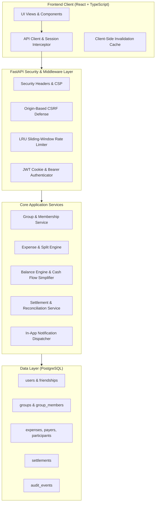

# PocketCircle System Architecture

This document describes the software design, component topology, data flows, and concurrency management strategies implemented in PocketCircle.

---

## 1. High-Level Architecture

PocketCircle is composed of three primary tiers:
1. **Client Tier:** A single-page application built with React, TypeScript, and Vite.
2. **API Tier:** An asynchronous REST API built with FastAPI (Python 3.12).
3. **Storage Tier:** A relational database (PostgreSQL in production/staging, with SQLite support for isolated automated tests).

---

## 2. Core Architectural Subsystems

### A. Authentication & Session Lifecycle
- **Tokens:** Signed JSON Web Tokens (HS256) deliver stateless user identification. Access tokens expire after 30 minutes; opaque refresh tokens (256-bit entropy, stored as SHA-256 hashes) expire after 30 days.
- **Delivery:** Access and refresh tokens are conveyed via `HttpOnly`, `SameSite=Lax` cookies, with automatic fallback support for `Authorization: Bearer <token>` headers on non-browser clients.
- **Rotation:** Refreshing a session revokes the existing refresh token and returns a fresh pair, stopping token replay attacks.

### B. Expense & Ledger Engine
- **Financial Precision:** All currency fields utilize Python's `Decimal` type quantized to two decimal places (`0.01`). Floating-point arithmetic is strictly forbidden.
- **Split Modes:**
  - *Equal Split:* Remainder cents are allocated deterministically by member UUID string sorting.
  - *Exact Split:* Participant shares are validated to sum identically to the total expense amount.
- **Multi-Payer Support:** Any subset of active group members can contribute partial amounts toward an expense, provided the sum of contributions equals the expense total.

### C. Greedy Cash Flow Simplification
- The debt simplification module computes net balances across all members:
  $$\text{Net Balance}_u = \sum \text{Paid}_u - \sum \text{Owed}_u + \sum \text{Settled Sent}_u - \sum \text{Settled Received}_u$$
- Non-zero balances are partitioned into debtors and creditors.
- A greedy matching algorithm pairs the largest debtor with the largest creditor, breaking ties deterministically using the member's UUID string.
- This guarantees full settlement in at most $N-1$ bilateral transfers for an $N$-member group without introducing intermediate fund holding.

### D. Concurrency & Data Isolation
- Critical state transitions (such as settlement confirmations and OTP validations) employ row-level locking (`SELECT ... FOR UPDATE` on PostgreSQL).
- Database operations are wrapped in asynchronous unit-of-work sessions committed only upon complete validation.
