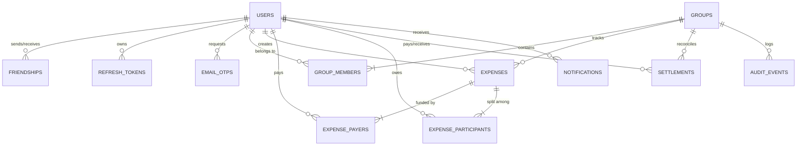

# PocketCircle Database Schema

This document details the relational data model, table structures, constraints, and indexes supporting the PocketCircle expense ledger.

---

## 1. Entity-Relationship Overview

---

## 2. Table Specifications

### users
Stores registered user accounts, authentication hashes, and display profiles.
- `id` (UUID, PK): Unique user identifier.
- `google_sub` (VARCHAR, Unique, Nullable): External Google OAuth identifier.
- `email` (VARCHAR, Unique, Indexed): User email address.
- `password_hash` (VARCHAR, Nullable): Salted PBKDF2 hash (310,000 iterations).
- `is_email_verified` (BOOLEAN): Email verification status.
- `name` (VARCHAR): Display name.
- `username` (VARCHAR, Unique, Indexed): Unique handle (max 20 chars).
- `pocket_id` (VARCHAR, Unique, Indexed): Canonical 10-digit numeric ID.
- `avatar_url` (VARCHAR, Nullable): Profile picture link.
- `created_at`, `updated_at`, `deleted_at`: Timestamps.

### friendships
Manages reciprocal social connections between users.
- `id` (UUID, PK)
- `user_id` (UUID, FK -> users.id)
- `friend_id` (UUID, FK -> users.id)
- `status` (VARCHAR): Connection status (`pending`, `accepted`, `rejected`).
- **Indexes & Constraints:**
  - `friendship_not_self`: Check constraint ensuring `user_id != friend_id`.
  - `unique_friendship_pair`: Unique functional index on `(LEAST(user_id, friend_id), GREATEST(user_id, friend_id))` stopping reciprocal duplicates.

### groups
Represents shared expense circles.
- `id` (UUID, PK)
- `name` (VARCHAR): Group title.
- `description` (VARCHAR, Nullable): Purpose or trip summary.
- `owner_id` (UUID, FK -> users.id): Primary circle administrator.
- `visibility` (VARCHAR): Access tier (`private`, `unlisted`, `public`).
- `created_at`, `updated_at`, `deleted_at`: Lifecycle timestamps.

### group_members
Associates users with groups and defines circle permissions.
- `id` (UUID, PK)
- `group_id` (UUID, FK -> groups.id, OnDelete CASCADE)
- `user_id` (UUID, FK -> users.id, OnDelete CASCADE)
- `role` (VARCHAR): Membership tier (`owner`, `admin`, `member`).
- `joined_at`: Timestamp of circle entry.
- `deleted_at`: Soft-delete timestamp (departure blocked if balance $\ne 0$).

### expenses
Records group expenditure events.
- `id` (UUID, PK)
- `group_id` (UUID, FK -> groups.id, OnDelete CASCADE)
- `creator_id` (UUID, FK -> users.id)
- `description` (VARCHAR): Purpose of the expense.
- `amount` (NUMERIC(12, 2)): Total monetary value (strict two-decimal precision).
- `split_type` (VARCHAR): Allocation mode (`equal` or `exact`).
- `created_at`, `updated_at`, `deleted_at`: Timestamps.

### expense_payers
Records which members paid money toward an expense.
- `id` (UUID, PK)
- `expense_id` (UUID, FK -> expenses.id, OnDelete CASCADE)
- `user_id` (UUID, FK -> users.id)
- `amount` (NUMERIC(12, 2)): Contributed share.

### expense_participants
Records the debt shares owed by participants for an expense.
- `id` (UUID, PK)
- `expense_id` (UUID, FK -> expenses.id, OnDelete CASCADE)
- `user_id` (UUID, FK -> users.id)
- `amount` (NUMERIC(12, 2)): Allocated owed portion.

### settlements
Records direct off-platform bilateral payments between circle members.
- `id` (UUID, PK)
- `group_id` (UUID, FK -> groups.id, OnDelete CASCADE)
- `payer_id` (UUID, FK -> users.id): Member sending money.
- `payee_id` (UUID, FK -> users.id): Member receiving money.
- `amount` (NUMERIC(12, 2)): Payment magnitude.
- `status` (VARCHAR): Lifecycle state (`pending`, `confirmed`, `rejected`, `cancelled`).
- `action_by_id` (UUID, FK -> users.id, Nullable): User who confirmed or rejected.
- `action_at` (TIMESTAMP, Nullable): Action timestamp.

### notifications & audit_events
- `notifications`: In-app event alerts with composite index `(recipient_id, is_read, created_at DESC)`.
- `audit_events`: Immutable security and financial audit trail recording actor, target entity, and payload details.
